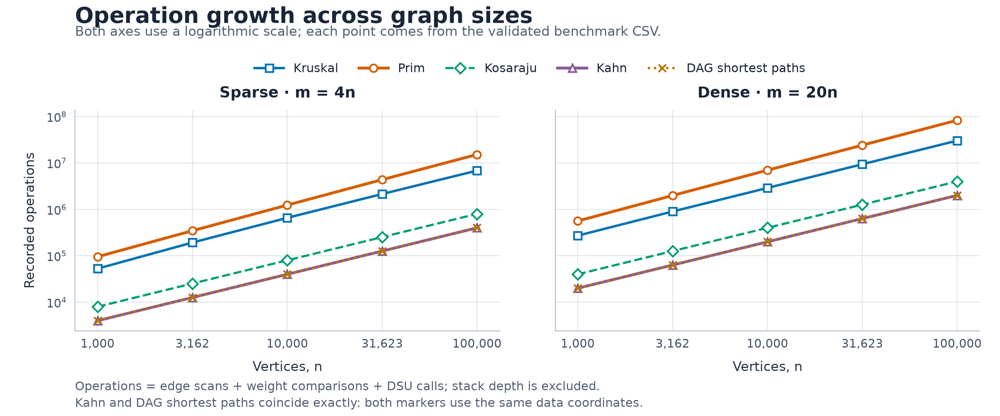
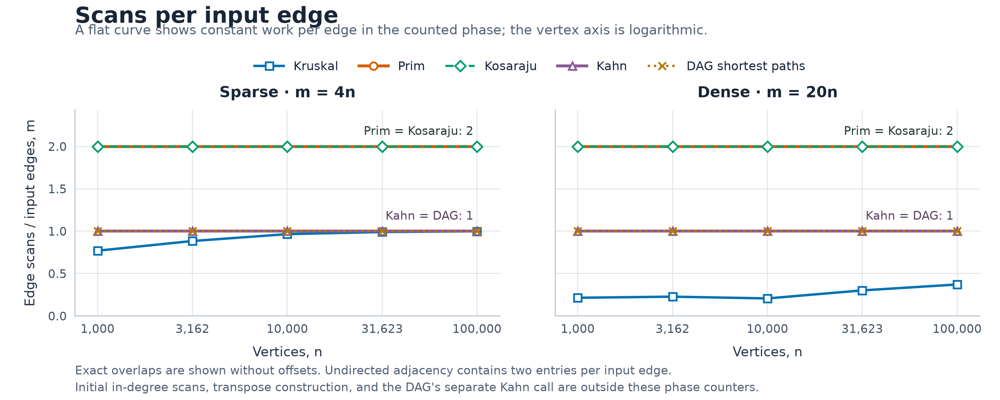
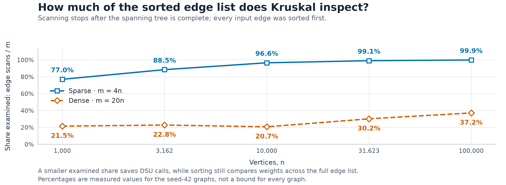
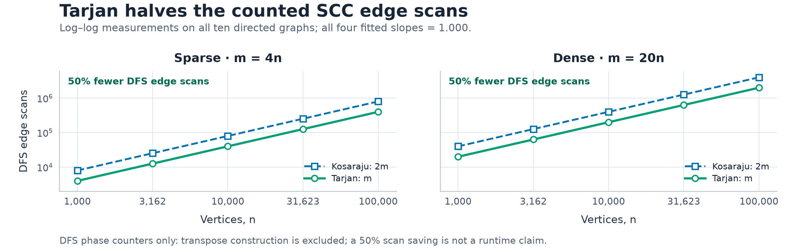
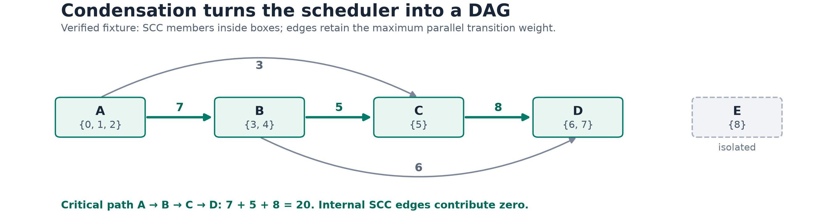

# Assignment 3 report

City Network & Job Scheduler

Design and Analysis of Algorithms · Assignment 3

Adilzhan Kuandykov | SE-2526 | 23 October 2026

Repository: https://github.com/adilzhandev/AITU-DAA-A3 | Release: v1.1 (both bonuses)

## 1. Implementation and experimental design

One adjacency-list Graph supports weighted multigraphs, loops, parallel edges, isolates and disconnected components. DSU uses size balancing and iterative compression. Kruskal and lazy Prim return forests; Kosaraju and Tarjan use explicit stacks; Kahn detects cycles. DAG shortest paths retain parents. The bonuses add one-pass Tarjan, SCC contraction and source-to-sink longest paths with restored critical paths.

The exact Random(42) generator restarts for n = 1,000, 3,162, 10,000, 31,623, 100,000 and m = 4n or 20n, creating undirected, directed and DAG inputs. The mandatory CSV retains 50 rows; bonus.csv adds 40 rows for Kosaraju, Tarjan, contraction and longest paths on the ten directed inputs. Each row records five-run median compute time without separate warm-up. Generation and validation are outside timing; repeated counters, all reference values, full SCC partitions and restored critical paths are checked.

## Complexity of the submitted implementations

| Operation | Time | Extra space | Reason |
| --- | --- | --- | --- |
| DSU find / union | O(α(V)) amortized | O(1) per call; O(V) structure | Size balancing + compression; makeSet costs O(V). |
| Kruskal | O(V + E log(E+1) + Eα(V)) | O(V+E) | Sort a copied edge list, then DSU checks; stop at V-1 selected edges. |
| Prim (lazy heap) | O(V + E log(E+1)) | O(V+E) | Scan adjacency lists; heap stores up to O(E) candidate edges. |
| Kosaraju | O(V+E) | O(V+E) | Two iterative DFS passes and an explicit transposed graph. |
| Kahn | O(V+E) | O(V) | In-degrees and queue; each vertex leaves once and each arc is removed once. |
| DAG shortest paths | O(V+E) | O(V) | Topological ordering plus one relaxation pass; distance and parent arrays. |
| Tarjan | O(V+E) | O(V) | One DFS, index/lowlink and active stack; no transpose. |
| Condensation | Expected O(V+E) | O(V+E) | Tarjan plus hash aggregation of maximum inter-SCC weights. |
| DAG longest paths | O(C+F) | O(C) | Kahn plus maximum relaxation on C components and F condensed arcs. |

V=n and E=m count original edges; an undirected edge occupies two adjacency entries. Space excludes the input graph and includes returned arrays/edges. For simple connected graphs log E = O(log V), but the implemented lazy Prim supports parallel edges, so O(E log E) is the precise heap bound. These linear-density inputs are both E=Θ(V); 'dense' here means 20n, not Θ(V²).

## What the counters measure

dsuOps counts find calls plus successful unions, not parent-pointer hops; comparisons counts sort/heap weight-comparator calls. edgeScans counts main-phase visits: candidates, adjacency/DFS scans, contraction or relaxations. It excludes transposition and in-degree setup. Longest/shortest path counters exclude their Kahn call; contraction excludes its Tarjan call, while their times include those prerequisites. maxDepth records peak explicit DFS-stack occupancy, not additive work.

<!-- page break in PDF -->

## 2. Correctness and verification

Cut property. Let A be an acyclic partial solution that is contained in some minimum spanning tree T. Consider a cut that no edge of A crosses, and let e be a lightest edge across that cut. If e is already in T, adding it to A is safe. Otherwise, adding e to T creates a cycle that contains another crossing edge f. Since w(e) ≤ w(f), replacing f by e preserves a spanning tree and cannot increase its weight. Kruskal applies this argument between DSU components, while Prim applies it between the visited vertices and the rest of the current connected component. Repeating the safe choice gives an MST, or independently one minimum tree per component for a disconnected graph.

Topological induction. Give every original zero-indegree vertex distance zero, equivalently adding a virtual source with zero-weight arcs to those vertices. Every vertex of a finite DAG is reachable from such a source. Assume that all vertices before u in a topological order already have their correct distances. Every incoming edge of u comes from one of those earlier vertices, so all possible final edges of a path to u have already been relaxed. The stored minimum is therefore the true shortest distance to u. Relaxing all outgoing edges of u maintains the induction, and parent updates preserve a path realizing each finite distance. The proof uses edge direction in the order rather than nonnegative weights, so negative edges are safe in a DAG, whereas general graphs need another method such as Bellman-Ford and reachable negative cycles prevent finite shortest-walk distances.

Verification: 122 JUnit tests pass with no failures, errors or skips. Coverage includes 1,000 random DSU unions against a label reference, 100 connected MST cross-checks, 80 exhaustive small forest oracles, 100 SCC graphs with up to 200 vertices against BFS reachability, 100 random DAGs against Bellman-Ford including negative weights and restored paths, cycle rejection and file parsing. The 100,000-vertex SCC path finishes with maxDepth=100,000. Four data/ fixtures exercise file loading, graph edge cases and the bonus scheduler.

Tarjan invariant. index fixes DFS discovery order; lowlink propagates child reachability and discovery indices of edges to still-active vertices. Edges to completed SCCs are ignored. When lowlink[u]=index[u], the active-stack suffix ending at u is precisely one SCC and is popped together. Explicit frames preserve recursive return updates without using the JVM call stack.

Condensation and longest paths. A directed cycle among distinct SCCs would make them mutually reachable, contradicting maximality, so contraction is a DAG. Keeping the largest parallel transition preserves the component-level maximum path; internal SCC cost is defined as zero. In topological order, every predecessor distance is final, so replacing min by max gives the correct longest distance by induction. This is the sign-flipped shortest-path recurrence, implemented directly in long arithmetic to avoid integer-negation overflow. Original sources start at zero and the critical endpoint must be a sink, including for negative weights.

## Reference checks and independent bonus tests

| n | Sparse: MST / SCCs / distance sum | Dense: MST / SCCs / distance sum |
| --- | --- | --- |
| 1,000 | 147,970 / 27 / 396,274 | 30,363 / 1 / 252,411 |
| 3,162 | 468,911 / 137 / 1,271,911 | 97,589 / 1 / 723,157 |
| 10,000 | 1,486,139 / 373 / 3,941,828 | 309,550 / 1 / 2,381,342 |
| 31,623 | 4,715,515 / 1,188 / 12,551,891 | 968,517 / 1 / 7,376,612 |
| 100,000 | 15,012,094 / 3,923 / 40,096,539 | 3,056,681 / 1 / 23,512,087 |

Both MST weights agree and Kahn returns n vertices in every case. Bonus tests compare Tarjan partitions with Kosaraju/BFS, condensed arcs with reachability-derived components, and longest paths with exhaustive enumeration on 150 shuffled DAGs including negative weights. Tarjan paths/cycles and longest paths survive 100,000 vertices. The scheduler fixture checks the full pipeline and a critical weight of 20. CSVs and logs retain every measured result.

<!-- page break in PDF -->

## 3. Operations and normalized complexity

The total is a selected-work proxy, not an instruction count or timing predictor. Ratios span all five sizes per density; a narrow range supports, but cannot prove, the complexity bound.

| Algorithm | Normalized counter | Sparse min to max | Dense min to max |
| --- | --- | --- | --- |
| Kruskal | comparisons / (m log₂m) | 0.745 to 0.907 | 0.666 to 0.903 |
| Kruskal | dsuOps / m | 1.791 to 2.248 | 0.465 to 0.794 |
| Prim | comparisons / (m log₂m) | 1.829 to 1.934 | 1.825 to 1.890 |
| Prim | edgeScans / (n+m) | 1.600 to 1.600 | 1.905 to 1.905 |
| Kosaraju | edgeScans / (n+m) | 1.600 to 1.600 | 1.905 to 1.905 |
| Kahn | edgeScans / (n+m) | 0.800 to 0.800 | 0.952 to 0.952 |
| DAG paths | edgeScans / (n+m) | 0.800 to 0.800 | 0.952 to 0.952 |

Traversal ratios are exactly constant: m=cn gives 2c/(1+c) or c/(1+c). Prim comparisons track m log m. Kruskal ratios vary with early stopping, adaptive sorting and 1,000 distinct weights. For k examined candidates and C components, dsuOps=2k+n-C, so dsuOps/k is between 2 and 3. Call counts cannot establish α(n); its bound follows from size balancing and compression.

## Log-log slope check

| Curve | Sparse slope | Dense slope | Minimum R² |
| --- | --- | --- | --- |
| Prim scans | 1.000 | 1.000 | 1.0000 |
| Kosaraju scans | 1.000 | 1.000 | 1.0000 |
| Kahn / DAG scans | 1.000 | 1.000 | 1.0000 |
| Kruskal scans | 1.055 | 1.119 | 0.9961 |
| Kruskal sort comparisons | 1.055 | 1.016 | 0.9995 |
| Prim heap comparisons | 1.108 | 1.090 | 0.9999 |

OLS fits log(counter)=a+b log(n) across five sizes. Traversal slopes are 1.000. Kruskal scan slopes reflect its changing examined fraction; E log E belongs to comparisons. The assignment conflates these phases. Slopes and R² describe this finite experiment, not a proof.

<!-- page break in PDF -->

## 4. Edge visits and algorithm choice

Prim scans both undirected adjacency entries; Kosaraju scans each directed edge in two DFS passes. Equal phase counts do not imply equal tasks or total work: the algorithms have different preprocessing and memory use.

Kruskal examines 77.0% to 99.9% of sparse edges and 20.7% to 37.2% of dense edges. Early stopping saves scans and DSU calls, but all edges are sorted first. Prim scans 2m entries and maintains its lazy heap. Comparison counts favor Kruskal here; this does not establish a universal winner.

| Situation | Choice and reason |
| --- | --- |
| Sparse undirected graph; edge list | Kruskal: direct sort plus DSU, straightforward forest handling. |
| Undirected graph; adjacency list | Prim grows a component naturally. This lazy heap uses O(E) space; compare counts before preferring it. |
| Truly dense simple graph, E≈V² | An O(V²) array/matrix Prim variant can avoid heap overhead; that variant is not implemented here. |
| Directed graph may have cycles | Tarjan saves a DFS pass and the transpose; Kosaraju is simple to cross-check. Kahn detects cycles for scheduling validity. |
| Acyclic jobs / weighted pipeline | Kahn for order; min relaxation for shortest routes, max relaxation for a critical source-to-sink path. |
| General weighted directed graph | DAG relaxation is invalid if cyclic. Dijkstra needs nonnegative weights; Bellman-Ford supports negative edges and detects reachable negative cycles. |

<!-- page break in PDF -->

## 5. Bonus evidence and scheduling interpretation

Tarjan saves the second DFS pass and the reversed graph; both algorithms remain O(V+E). Its scan slope is 1.000, with scans/(n+m)=0.800 sparse or 0.952 dense. Full SCC memberships match via a label-independent bijection. These phase counts exclude transpose construction, and 50% fewer scans do not promise 50% less time.

At n=100,000 and m=400,000, contraction yields 3,923 components and 4,331 arcs; the critical weight is 4,977. Every generated dense directed input collapses to one SCC, leaving zero arcs and critical weight zero. The explicit scheduler fixture below therefore demonstrates a nontrivial path.

For nonnegative transition durations and unlimited resources, a critical path gives the minimum completion time imposed by dependencies; delaying a zero-slack task delays that completion. A DAG needs one topological relaxation pass. In a general directed graph, longest simple path is NP-hard, while an allowed walk can be unbounded if a relevant positive cycle exists. SCC contraction only models transitions between groups: it discards internal duration and does not resolve a deadlock or recover an original-graph longest path.

Timing. On the largest dense graph, median times in ms were Kruskal 457.886, Prim 2,419.650, Kosaraju 697.304, Kahn 130.710, DagShortestPath 260.683. Environment: openjdk version "17.0.20.1" 2026-08-18; Ubuntu 26.04.1 LTS; Intel(R) N100; -Xms256m -Xmx3g. Five-run medians reduce outliers but do not remove JVM compilation, allocation/GC, background load or hardware effects; the small inputs are especially noisy. Counters and reference checks are the primary evidence. Machine details and test totals are recorded in results/environment.json.

Reproduction and provenance. After installing scripts/requirements.txt, run bash scripts/reproduce.sh to test, benchmark and rebuild both CSVs, five figures and this report. The Java tests and benchmark are the correctness evidence; scripts/plot_results.py validates the CSV and stores numerical fits in results/analysis.json. The bonus release is v1.1 on main; v1.0 preserves the mandatory-only baseline. Feature branches retain both bonus implementations and their evidence. Source: Taubakabyl Nurlybek, DAA Assignment 3 - Graphs (supplied specification), sections 1-10 and Bonus Points. AI acknowledgement: the student supplied the initial Java implementations; OpenAI Codex assisted with bonus implementation, auditing, tests, measurement, figures, report and release preparation.
